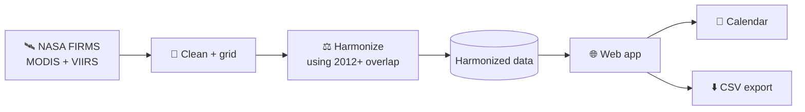

<div align="center">

# 🔥 Harmonized Burning Activity Calendar

**Two decades of MODIS + the detail of VIIRS, in one consistent fire history.**


[Problem](#-the-problem) · [Features](#-features) · [How it works](#-how-it-works) · [Preview](#-preview) · [Getting started](#-getting-started)

</div>

---

## 🌍 The problem

MODIS has 20+ years of active-fire data but is nearing the end of its life and being replaced by VIIRS. The two sensors differ in resolution, sensitivity and overpass times, so their records can't be compared directly.

Emergency managers need one consistent hotspot calendar to answer questions like:

> *Which months and years had the most fires? How does this month compare with the historical median?*

## ✨ Features

| | |
|---|---|
| 🛰️ **Harmonized data** | MODIS and VIIRS hotspots merged into one time series |
| 🗺️ **Pick any area** | Draw on the map or enter lat/lon |
| 📅 **Burning calendar** | Hotspot counts by month and year, early 2000s to today |
| 📊 **Anomalies** | Current month vs. historical median |
| 🎨 **Accessible colors** | Colorblind-safe ramps |
| ⬇️ **Export** | CSV of detected hotspots and chart downloads |

## 👀 Preview

A sketch of the calendar view (darker = more hotspots):

| Year | Jan | Feb | Mar | Apr | May | Jun | Jul | Aug | Sep | Oct | Nov | Dec |
|------|:---:|:---:|:---:|:---:|:---:|:---:|:---:|:---:|:---:|:---:|:---:|:---:|
| 2021 | 🟨 | 🟨 | 🟧 | 🟥 | 🟧 | 🟨 | ⬜ | ⬜ | ⬜ | 🟨 | 🟨 | 🟨 |
| 2022 | 🟨 | 🟧 | 🟥 | 🟥 | 🟧 | 🟨 | ⬜ | ⬜ | ⬜ | ⬜ | 🟨 | 🟨 |
| 2023 | 🟧 | 🟥 | 🟥 | 🟫 | 🟥 | 🟧 | 🟨 | ⬜ | ⬜ | 🟨 | 🟨 | 🟨 |

> Illustrative only. The real app will use a colorblind-safe ramp with live data.

## ⚙️ How it works



1. **Ingest** hotspots from FIRMS and drop low-confidence detections.
2. **Aggregate** to a common grid and monthly step to offset the 1 km vs 375 m difference.
3. **Calibrate** the sensors on their overlap period (2012 onward).
4. **Serve** the result to the web app, where users pick an area and date range.

## 🧰 Tech stack (tentative)

`Python` · `pandas` · `geopandas` · `Parquet` · `Leaflet` · `Plotly`

## 🚀 Getting started

```bash
git clone <repo-url>
cd <repo-name>
pip install -r requirements.txt
```

## 📂 Data

- [NASA FIRMS](https://firms.modaps.eosdis.nasa.gov/): MODIS (~1 km) and VIIRS (~375 m) active fires

## 👥 Team

| Name | Role |
|------|------|
| TBD | TBD |

---

<div align="center">
Built with open data from NASA Earthdata 🛰️
</div>
